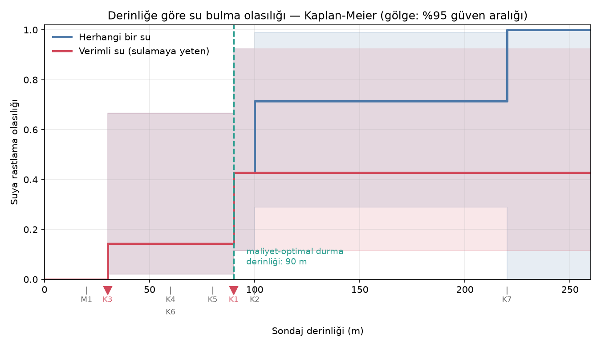

# kuyu-tahmin — yeraltı suyu tahmini denemesi (ve neden başarısız olduğu)

Bir fıstık tarlasında sondaj kuyusu açarken kuru kuyu maliyetini azaltmak için
"suyun nerede olduğunu" tahmin eden bir model kurma denemesi.

**Sonuç: mekânsal tahmin modeli başarısız oldu.** Bu depo o başarısızlığı,
nasıl tespit edildiğini ve geriye ne kaldığını belgeliyor.

> **TL;DR (English):** An attempt to predict groundwater locations in a ~10 ha
> pistachio orchard from 13 borehole observations. The anisotropic kriging-style
> model reached a leave-one-out skill of 0.33 — but a permutation test showed
> randomly shuffled data reached the same skill (p = 0.45). The "structure" was
> an artifact of searching 2592 parameter combinations on 13 points. No
> prediction map was published. What survived: an evidence map, a
> censored-depth (Kaplan-Meier) model that answers *how deep to drill*, and a
> cost model. Coordinates in this repo are anonymized.

---

## Problem

Karstik (kireçtaşı) arazide sulama kuyusu açılıyor. Bazı kuyular iyi su
veriyor, bazıları tamamen kuru çıkıyor ve her kuru kuyu ciddi bir masraf.
Soru: bir sonraki kuyuyu nereye vurmalı?

Eldeki veri:

- Tarla sınırı (7 köşe, ~103 dönüm / ~10,3 hektar)
- Tarla içinde 8 sondaj noktası: 2 verimli, 1 zayıf, 4 kuru, 1'inde 20 m'de mağara
- Çevrede 5 kuyu daha (gözlem olarak, müdahale edilmeyen)
- 1 adet tracer (izleyici) testi: bir kuyuya dökülen kimyasalın kokusu başka
  bir kuyudan geldi → iki kuyunun hidrolik bağlantısı kanıtlandı

## Denenen yöntem

Anizotropik çekirdek (kriging benzeri) ile su potansiyeli yüzeyi:

- Her gözlem bir "verim skoru" (0–1) ve bir güven ağırlığı taşır
- Çekirdek yönlüdür: varsayılan kanal ekseni boyunca bilgi uzağa taşınır,
  eksene dik yönde hızla söner
- Parametreler (eksen açısı, iki menzil, büzüşme ağırlığı) leave-one-out
  çapraz doğrulama ile veriden seçildi

İlk sonuçlar umut vericiydi: LOO becerisi **0.33**, ve yönlü model yönsüz
(izotropik) modelin iki katı başarılıydı. Tam burada durup haritayı yayımlamak
cazipti.

## Başarısızlığın tespiti

Asıl soru şuydu: bu beceri gerçek bir yapıdan mı geliyor, yoksa yüzlerce
parametre kombinasyonu denenirken rastlantısal olarak mı yakalandı?

**Permütasyon testi:** kuyu skorları konumlar arasında rastgele karıştırılıp
aynı parametre araması 500 kez tekrarlandı.

| Ölçüt | Değer |
|-------|-------|
| Gerçek veride en iyi LOO becerisi | **0.327** |
| Karıştırılmış veride ortalama beceri | **0.325** |
| Karıştırılmış veride %95 dilim | 0.537 |
| **p-değeri** | **0.452** |

Rastgele veri, gerçek veriyle **aynı** beceriyi üretiyor. Bulunan "kanal
doğrultusu" gerçek bir jeolojik yapı değil, arama gürültüsüydü.

Bu yüzden düzgün geçişli bir "su potansiyeli" ısı haritası **üretilmedi**.
Bilimsel görünen ama tahmin gücü yazı-turadan farksız bir harita, sondaj
kararlarını yanlış yönlendirir ve doğrudan para kaybettirir.

Üretme kodu depoda duruyor (`dogrulama.py`), çünkü asıl anlatılmak istenen
sonucun kendisi değil, nasıl çürütüldüğü.

## Neden başarısız oldu — üç sebep

**1. Fiziksel sebep: heterojenlik ölçeği, örnekleme aralığından küçük.**
Tarlada 47–49 m arayla sulu/kuru kuyu çiftleri var. Yani yeraltı yapısı ~50 m
ölçeğinde değişiyor, ama kuyular arası tipik mesafe ~300 m. Karstta su tabaka
halinde değil dar kanallarda akar; aradaki boşluğu enterpolasyonla doldurmak
prensip olarak mümkün değil. Daha iyi bir algoritma bunu çözmez.

**2. Metodolojik hata: çoklu karşılaştırma.** 13 veri noktasına karşılık 4
serbest parametre ve 2592 kombinasyonun en iyisinin seçilmesi. Bu kurgu
rastgele sayılardan bile "anlamlı" yapı çıkarır. Permütasyon testi olmasaydı
bu hata fark edilmeyecekti.

**3. Veri miktarı.** 13 noktanın yalnızca 4'ü pozitif. Kaba bir kural olarak
bir tahmin değişkenini güvenilir sınamak için ~10 pozitif örnek gerekir. Bu
veriyle sıfır değişkenli bir model bile zor taşınır.

## Geriye ne kaldı

Mekânsal tahmin çöktü ama veri başka sorulara cevap verebildi.

### 1. Sansürlü derinlik modeli (asıl işe yarayan sonuç)

Kritik yeniden çerçeveleme: **kuru kuyu bir başarısızlık değil, sansürlü
gözlemdir.** 80 m'de bırakılan bir kuyu "burada su yok" demez, "ilk 80 m'de su
yok" der. Bu, hayatta kalma analizinin (Kaplan-Meier) tam olarak çözdüğü
problem — ve hiçbir parametre aranmadığı için aşırı uyum riski yok.



Sonuç:

| Derinlik | Herhangi bir su | Verimli su | %95 güven aralığı |
|----------|-----------------|------------|-------------------|
| 30 m | 14% | 14% | 2% – 67% |
| 90 m | 43% | **43%** | 11% – 92% |
| 220 m | 100% | 43% | 11% – 92% |

Derine inmek suya *rastlama* şansını artırıyor, ama *işe yarar* su bulma
şansını artırmıyor: 90 m'den derinde hiç verimli su bulunmamış. Bir kuyu 220
m'ye indi ve 8 saatte 40 dakika veren zayıf bir kuyu çıktı.

Metre başı maliyetle birleştirince: hedef derinlik **~90 m** olmalı, 180 m
değil. Verimli kuyu başına beklenen maliyet farkı kayda değer.

### 2. Kanıt haritası

Tahmin yerine doğrudan gözlem: her sondaj noktasının 40 m'lik kanıt alanı
(sulu/kuru), mağara risk bölgesi, tracer testiyle kanıtlanmış bağlantı. Renksiz
kalan her yer açıkça "test edilmemiş" olarak işaretli.

### 3. Maliyet / karar analizi

Wilson güven aralıklı başarı oranları, sığ bırakılmış kuyuları derinleştirmenin
yeni kuyu açmaya kıyasla maliyeti, ve jeofizik etüt için başabaş noktası
("etüt, başarı oranını kaç puan artırırsa masrafını çıkarır").

## Dosyalar

| Dosya | İş |
|-------|-----|
| `dogrulama.py` | Modelin geçerlilik sınaması: LOO + permütasyon testi |
| `derinlik_modeli.py` | Sansürlü derinlik modeli (Kaplan-Meier + maliyet optimizasyonu) |
| `maliyet_analizi.py` | Başarı oranları ve karar/maliyet analizi |
| `kanit_haritasi.py` | Doğrudan gözlem haritası (tahmin içermez) |
| `tahmin_motoru.py` | Ortak veri/geometri katmanı, anizotropik çekirdek |
| `kuyu_haritasi.py`, `sinir_kontrol_haritasi.py` | Veri toplama/kontrol haritaları |
| `araclar/anonimlestir.py` | Gerçek veriden anonim örnek veri üretir |

Üretilen raporlar: `dogrulama_raporu.md`, `derinlik_raporu.md`,
`maliyet_raporu.md`.

## Veri gizliliği

Gerçek GPS koordinatları **bu depoda yok** ve `.gitignore` ile dışlanmış.
Özel mülkün ve komşulara ait kuyuların konumlarını açık ederlerdi.

`ornek_veri/` içindeki veri anonimleştirilmiştir: tarla merkezi orijin alınıp
tüm noktalar yerel metre düzlemine taşınmış, sonra hayali bir orijin olan
**0°N 0°E** etrafında yeniden kodlanmıştır. Kuyular arası **mesafeler ve açılar
birebir korunur**, gerçek konum tamamen kaybolur. Tüm analizler anonim veriyle
aynı sayısal sonucu verir (doğrulandı).

Bunun bedeli: uydu görüntülü haritalar anlamlı render edilmez, çünkü gerçek
koordinat gerektirirler. Haritalar bu yüzden depoya dahil edilmemiştir.
Yer adları ve metin içindeki koordinat kalıntıları da temizlenmiştir.

## Çalıştırma

```bash
pip install numpy scipy matplotlib folium
python dogrulama.py          # model geçerlilik sınaması
python derinlik_modeli.py    # derinlik modeli + grafik
python maliyet_analizi.py    # maliyet analizi
```

`data/` klasörü yoksa kod otomatik olarak `ornek_veri/` kullanır.
Fiyat varsayımları `ornek_veri/maliyetler.json` içindedir ve yer tutucudur.

## Bu depodan çıkarılmaması gereken sonuç

"Yeraltı suyu tahmin edilemez" değil. Çıkarılması gereken şu: **13 noktayla,
heterojenliği 50 m ölçeğinde olan bir ortamda mekânsal enterpolasyon
yapılamaz** — ve bir modelin çapraz doğrulama skoru iyi diye gerçek olduğu
sanılmamalıdır. Permütasyon testi bu ayrımı yapan en ucuz araçtır.

Mekânsal tahminin anlamlı hale gelmesi için gereken, daha iyi bir algoritma
değil, farklı cinsten veri: jeofizik özdirenç etüdü (kanalları doğrudan
görüntüler), her yeni kuyuda tabaka kayıtları, kuyularda su seviyesi ölçümleri,
ve kasıtlı tracer testleri (negatif sonuçlar dahil).

## Lisans

MIT — bkz. [LICENSE](LICENSE).
